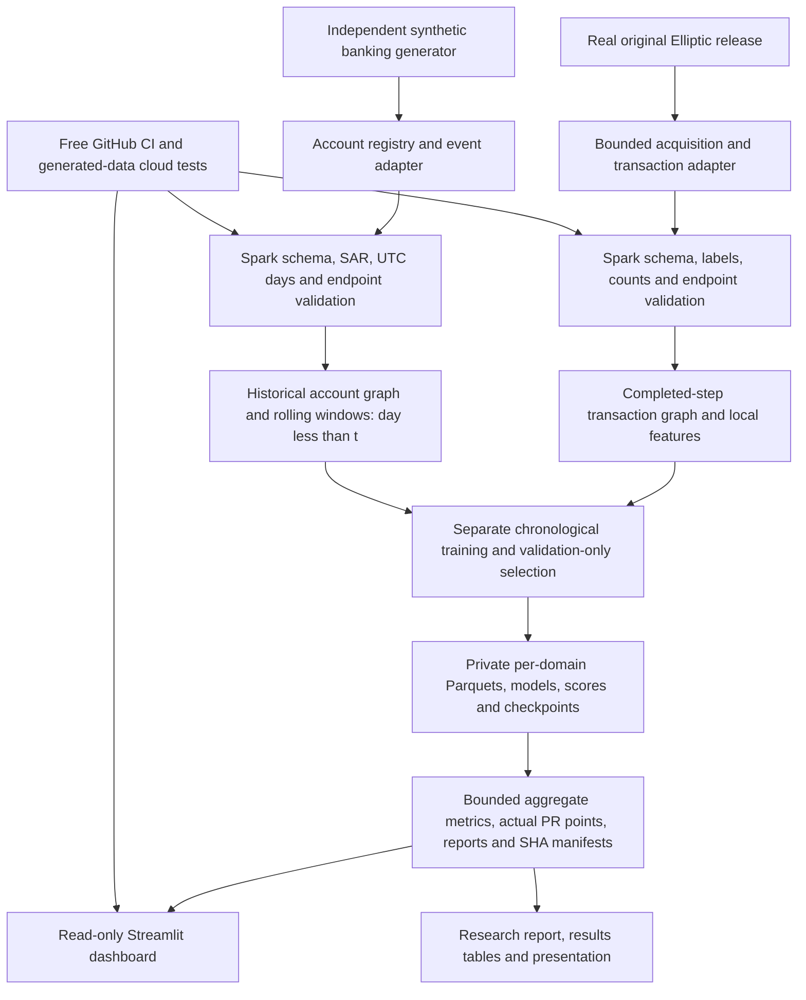

# Project architecture

| Domain | Nodes | Edges | Clock | Positive target |
| --- | --- | --- | --- | --- |
| Real Elliptic | Transactions, not wallets | Directed transaction flow, simple edges | Released steps 1–49 | Known illicit transaction |
| Independent synthetic banking | Persistent accounts | Payment events; repeated pairs retain multiplicity | UTC simulation days 0–49 | Account participates in simulated SAR payment on forecast day |

The graphs and labels are never concatenated. A shared metrics interface does not
make targets or AP values comparable. Unknown Bitcoin labels are not negatives;
missing banking SAR labels are rejected. An external AMLSim-compatible input is
marked unverified, never silently attributed to IBM or relabeled real data.

## Execution boundaries

- `adapters/`, `data/`: bounded dependency-free source contracts, safe acquisition,
  publisher/license/size review, generated fixtures and independent simulation.
- `spark/`: CSV validation, normalized node/edge tables, exclusive-cutoff graph
  snapshots and Parquet persistence. Small reference `features.py` uses inclusive
  cutoffs; it is not the forecasting/training implementation.
- `spark/research.py`, `spark/banking_research.py`: Spark ingestion followed by
  bounded sparse **single-host CPU** graph mining. PageRank/community algorithms
  are not claimed to be distributed Spark algorithms.
- `training/`: train-fitted transforms, fixed model grids, validation AP selection,
  validation-only thresholds, held-out metrics and exploratory block bootstrap.
- `automation.py`, `cloud_job.py`, `banking_job.py`: cloud guards, immutable run
  fingerprints, phase diagnostics, resource budgets, verified checkpoint reuse,
  private output persistence and allowlisted aggregate publication.
- `evidence.py`: separate-domain snapshot hashes, target/order/count validation,
  confusion-matrix arithmetic, finite scores and measured PR-point contracts.
- `dashboard/app.py`: UI-only dependencies; no acquisition, training, Spark start,
  user uploads or pickle loading. Default graphs are illustrations. Optional
  private graph provenance is an operator assertion, not source authentication.

## Storage and resource boundaries

Source rows, feature tables, prediction arrays and models stay outside the
checkout and public CI artifacts. Public artifacts contain only allowlisted
aggregate reports/plots with hashes and seven-day retention. Git snapshots retain
aggregate evidence beyond that retention. Colab can persist private checkpoints
in authorized Drive; GitHub runners clean private workspaces after jobs.

All measured Spark runs use **one machine, `local[2]`**. Generated benchmark tables
state heap, partitions, versions, observed CPU visibility, counts and timing scope.
Sklearn models are bounded CPU work; free cloud availability is not guaranteed.
See [cloud execution](cloud-execution.md), [methodology](methodology.md) and
[research report](final-research-report.md).
