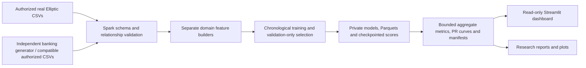

# MMDS: Financial Graph Mining and Suspicious-Activity Research

## Scope and provenance

This project studies two separate financial graph tasks. Elliptic uses the real
original Bitcoin transaction release: 203,769 transaction nodes, 234,355 directed
links, 49 released time steps, 4,545 illicit / 42,019 licit / 157,205 unknown labels.
Banking uses an **independently generated synthetic** AMLSim-compatible dataset:
500 persistent accounts, 33,600 payment events and 24,500 forecast account-days per
seed, with three fixed independent seeds. It is not official AMLSim output or
verified real bank fraud. SAR involvement is a simulation target, not confirmed
fraud or proof that the account owner laundered money.

## Unified architecture

Shared components cover validation, checkpoint hashes, bounded resources, metrics
and publication. Domain adapters preserve different node semantics, edge
multiplicity, clocks and targets. The lightweight UI has no training/Spark runtime,
no dataset downloads and no model deserialization. Only aggregate snapshots are
versioned; raw data, predictions and models remain outside Git and public reports.

## Methodology and temporal availability

Elliptic trains steps 1–34, validates 35–39 and tests 40–49. Known supervised counts
are 29,894 / 5,486 / 11,184, with 3,462 / 447 / 636 illicit rows. Unknowns are never
negatives. Completed-step graph availability is explicitly retrospective. Source
local attributes (93 numeric features) are included; all 72 anonymous neighborhood
aggregates are excluded. Publisher-local construction/normalization/live availability
has not been independently established, so no live production causality is claimed.

Banking predicts account involvement in a simulated SAR payment on day t using
only events before day t. Training days 1–34, validation 35–39, test 40–49 give
17,000 / 2,500 / 5,000 account-days per seed. All accounts are registered by day zero.
Same accounts across periods measure forecasting for known entities, not unseen
customers. Repeated payment IDs retain multiplicity; SAR flags, alert IDs, account
IDs and static account labels never enter predictors. Missing labels are rejected.

Both use fixed bounded candidate grids, train-fitted scaling, chronological splits,
validation AP model selection and thresholds maximizing validation F1 under 5%
validation FPR. That cap is not a test guarantee. AP means average precision, not
trapezoidal PR integration. Precision/recall/F1/FPR and confusion matrices refer to
held-out known classes. Model/threshold choices never use test scores. Measured PR
curves contain sampled actual ranking points; no curve is inferred from AP alone.

## Experiments, ablations and verified historical results

The Phase 4 Elliptic study added directional PageRank, weak components, bounded
community structural features, historical label context and five-step rolling
population anomalies. Eight fixed families/ablations used 36 fits. The frozen
transaction baseline was preserved. Historical PR #12 held-out results:

| Elliptic model | AP | F1 | Recall | FPR |
| --- | ---: | ---: | ---: | ---: |
| Frozen transaction-only | .652145 | .669811 | .558176 | .006542 |
| Transaction + graph | .654507 | .677450 | .559748 | .005593 |
| Transaction + rolling | .658517 | .680374 | .572327 | .006636 |
| Full combined | .659236 | .687324 | .575472 | .005973 |
| Validation winner: without components | .657412 | .692382 | .564465 | .003982 |

The highest test AP was not used to retrospectively select a model. AP/F1 intervals
for the validation winner included zero relative to baseline. FPR was lower, but
no reliably established overall or live-deployment improvement is claimed.

The graph audit found **zero cross-step edges**, backward-time edges or historically
labeled neighbors. Persistent-wallet histories cannot be recovered from transaction
IDs. Historical label features remain zero; degree features are partly redundant.
Known illicit prevalence falls from 11.58% in training to 5.69% in test. Community
size and neighbor-degree distributions shift; both baseline and added models lose
performance in several late steps. These measured associations do not identify a
causal external event. Earlier PRs already inspected the test period, so it is not
an untouched external lockbox.

The Phase 5 banking study ran 20 supervised candidates plus one unsupervised
Isolation Forest per fixed seed. Means below are **synthetic** held-out scores,
not pooled customer predictions:

| Synthetic banking family | AP | F1 | Recall | FPR |
| --- | ---: | ---: | ---: | ---: |
| Transaction-only | .226261 | .315831 | .415959 | .029754 |
| Graph-only | .100943 | .115577 | .104759 | .018879 |
| Temporal-only | .274448 | .328378 | .419710 | .027356 |
| Combined | .432368 | .501451 | .575433 | .018676 |
| Isolation Forest | .145012 | .207695 | .284524 | .037758 |

Combined was validation-selected for all seeds. Its test AP varies .281991–.549954;
seed 1's improvement interval includes zero. Learnable persistent motifs and benign
lookalikes are intentionally generated. Three synthetic repetitions cannot establish
real-world efficacy, coverage of unseen laundering typologies or transfer to banks.
Isolation Forest fits without labels; its sigmoid anomaly score is not calibrated
fraud probability. Full per-seed matrices, thresholds, warning logs and candidate
scores are in linked aggregate artifacts and the dashboard snapshots.

## Statistical comparisons

Five hundred seeded paired source-period bootstrap draws compare a model with the
transaction baseline on identical held-out rows. Ten held-out periods, persistent
accounts, campaign structure and overlapping windows limit independence. Intervals
are exploratory and uncorrected for multiple comparisons. Numeric tie sensitivity
can change ranking-based validation AP slightly across distributed reruns; no
bitwise reproducibility claim is made for all floating-point intermediates. Frozen
references are retained, and differences are reported rather than hidden by tuning.

## Processing benchmarks and configuration

The Phase 6 benchmark actually executed Spark ingestion/validation, graph summaries,
and Parquet write/read/count on generated Bitcoin fixtures (100, 500, 1,000 nodes)
and synthetic banking fixtures (100, 500, 1,000 accounts; 8,600 / 28,600 / 53,600 events).
It used **one cloud machine, local[2], 1 GB driver heap, 2 shuffle partitions**,
Spark 4.0.1, Java 21, Python 3.12.14 and two concurrent Spark task slots. Detailed
versions, input byte counts, observed CPU visibility and timings are in the
hash-verified `dashboard/data/spark-benchmarks.json` and plotted in the app.

| Generated workload | Nodes/accounts | Events/edges | Seconds |
| --- | ---: | ---: | ---: |
| Bitcoin correctness fixture | 100 | 99 | 15.466 |
| Bitcoin correctness fixture | 500 | 499 | 8.944 |
| Bitcoin correctness fixture | 1,000 | 999 | 8.197 |
| Independent synthetic banking | 100 | 8,600 | 2.182 |
| Independent synthetic banking | 500 | 28,600 | 2.382 |
| Independent synthetic banking | 1,000 | 53,600 | 2.721 |

Source generation and Spark startup are excluded; first measured processing is cold
and later work shares a warm JVM. One repetition per size; topology/compression and
warm-up confound timings. These observations do not establish monotonic scaling,
production throughput or distributed multi-worker speedup. **No multi-worker cluster
was run.** CI separately reruns the benchmark and exports its own measured JSON;
its hardware/runtime and timings can differ from the bundled Codex measurements.

## Reproducibility, resource and access boundaries

All implementation/tests/experiments use Codex Cloud or free public GitHub Linux.
No Mac execution, paid cloud or GPU is used. Existing source license/version/size
review, dataset byte limits, timeouts, private checkpoint hashes and cleanup remain.
Official AMLSim core is Apache-2.0, but its documented legacy stack pins NetworkX
1.11, which imports removed fractions.gcd. The independent fallback is explicit;
no official generator or unreviewed jar/install script was executed.

The dashboard provides separate datasets/statistics, interactive graph exploration,
temporal observations, per-domain comparisons, confusion matrices, measured PR
curves, benchmark configurations and this report. Default graph views are generated
illustrations, never represented as real transaction samples or measured experiment
subgraphs. Optional bounded operator-authorized cloud subgraphs remain outside Git.

A public Streamlit hosting URL has not been verified merely by passing cloud tests.
Free Community Cloud publication requires external account/GitHub authorization;
[dashboard access instructions](dashboard.md) specify the exact entry point and
lightweight dependencies. No manual Colab/debugging or local server is required.

## Conclusions and limitations

Publisher-local transaction attributes dominate this Elliptic benchmark; structural
additions show modest, uncertain AP gains and a useful observed FPR tradeoff. The
release's disconnected periods prevent persistent-account history claims. In the
independent banking simulation, temporal and combined models use recurring account
patterns more effectively than cumulative graph features alone, but performance
varies substantially by seed. Unknown real-world labels, synthetic design assumptions,
prior test inspection and limited source periods constrain conclusions.

The useful unified result is reproducible engineering with clear evidence boundaries,
not a universal fraud score or a claim that the two domains' AP values rank difficulty.
Next research steps require independently authorized banking data or a maintained
AMLSim stack, additional untouched temporal cohorts and genuinely distributed cluster
experiments before making production or multi-worker scaling claims.

## Evidence sources

- [Elliptic Phase 4 verified protocol/results, PR #12](https://github.com/ojassgambira/MMDS/pull/12).
- [Synthetic banking and Elliptic preservation, PR #13](https://github.com/ojassgambira/MMDS/pull/13).
- Current dashboard snapshots include exact source workflow URLs and artifact digests;
  `dashboard/data/manifest.json` verifies their committed bytes.
- [Phase 4 protocol](phase4-research.md), [banking protocol](phase5-banking.md),
  [dashboard/cloud access](dashboard.md). Artifact retention is seven days; versioned
  aggregate snapshots and PR summaries retain the measured record afterward.
